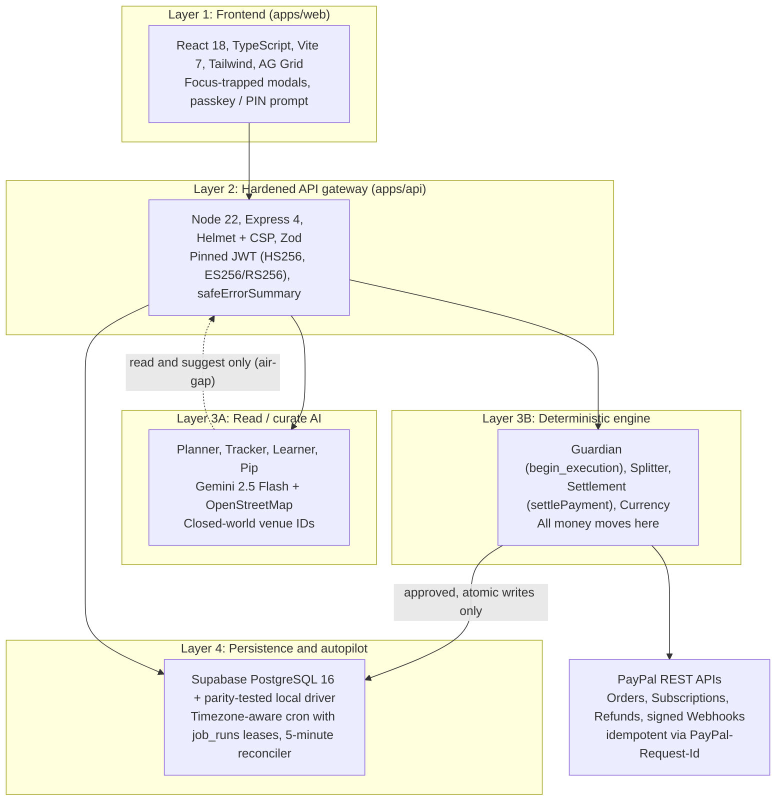

# Pocketful

An AI weekend companion for your PayPal wallet. It plans, splits and saves, and never spends a cent without your approval.

Everyone is building AI agents that talk. Pocketful is an agent you can trust with money, because the part that talks cannot move it. A language model suggests, you approve with a passkey, and deterministic code re-checks your limits and pays exactly once.

Built for the PayPal AI Hackathon by Divyansh Garg. The demo runs on seeded data and the PayPal sandbox.

- **[Video Demo](https://youtu.be/OTTXTo9i2dI)**
- **[Live Web App](https://pocketful-web.onrender.com)**
- **[Deck](Pocketful_Deck.pdf)**
- **[API Reference](openapi.yaml)**

### Verified in this repository

| Check | Result |
|---|---|
| `npm run typecheck` | 0 errors (API and web) |
| `npm run lint` | 0 problems |
| `npm test` | 650 passed, 0 failed (573 API in 47 files, 77 web in 9 files) |
| `node scripts/verify-fixes.mjs` | 79 of 79 live probe checks pass, run twice with identical results |
| `npm run test:db` | 73 tests against real PostgreSQL 16 (CI job `db-tests`) |
| `npm audit` | 0 vulnerabilities (development and production dependencies) |

---

## Contents

1. [The problem](#1-the-problem)
2. [What Pocketful does](#2-what-pocketful-does)
3. [The trust model](#3-the-trust-model)
4. [Features by screen](#4-features-by-screen)
5. [Architecture](#5-architecture)
6. [Security invariants](#6-security-invariants)
7. [Step-up verification in detail](#7-step-up-verification-in-detail)
8. [Money handling](#8-money-handling)
9. [Database](#9-database)
10. [Background jobs](#10-background-jobs)
11. [API reference](#11-api-reference)
12. [Configuration](#12-configuration)
13. [Quickstart](#13-quickstart)
14. [Testing and verification](#14-testing-and-verification)
15. [Operational runbooks](#15-operational-runbooks)
16. [Project structure](#16-project-structure)
17. [Partner stack](#17-partner-stack)
18. [Roadmap and business model](#18-roadmap-and-business-model)
19. [Known limitations](#19-known-limitations)
20. [Further documentation and license](#20-further-documentation-and-license)

---

## 1. The problem

Weekends cost us guilt, time and money.

- **Budget guilt.** Budgeting apps tell you that you overspent after you have already done it.
- **Friday fog.** By Friday evening you are too tired to choose a plan, so you stay home.
- **Forgotten subscriptions.** Services that nobody uses quietly cost between $50 and $150 a month.
- **Awkward splits.** $100 / 3 is $33.33 three times, which is $99.99. Someone eats the cent, and in most apps that someone is the organizer.

Traditional finance apps are reactive: they report on what already happened. Pocketful is proactive: it works out what you can spend before you spend it, and it holds every money-moving step behind your explicit approval.

---

## 2. What Pocketful does

Pocketful runs one loop, Friday to Sunday, on top of an always-on baseline.

| Stage | When | What happens |
|---|---|---|
| **Know** | Always on | Ingests past PayPal and ledger transactions, deduces your fixed bills, and computes your exact guilt-free fun money for the week. No surveys. |
| **Recover** | Friday morning | Finds subscriptions with no activity for 90 or more days (ghost subscriptions) and stages a one-tap cancellation for your approval. |
| **Plan** | Friday 5 PM | Builds three real outings for your mood from closed-world local venues: Comfort, Stretch and New. |
| **Split** | Saturday | Friends pay their exact share through PayPal checkout links. Whole-cent math, no lost pennies. |
| **Sweep** | Sunday | Unspent fun money moves into your vault, behind the same approval. |

Every step that moves money asks for your approval.

### Headline numbers in the seeded demo

The demo wallet shows a guilt-free fun money figure of $140.00 "free for the weekend", and the Ledger screen surfaces a ghost subscription unused for 90+ days with a "Cancel and reinvest" action.

---

## 3. The trust model

**AI suggests. You approve. Code pays.**

- **The AI suggests.** Gemini 2.5 Flash writes suggestions and explanations. It has no database access and no way to move money.
- **You approve.** You hold the approval seal for 1.2 seconds (or use the keyboard path) and approve with your passkey. The approval is cryptographically tied to that exact action, amount and payload.
- **The Guardian executes.** Deterministic, non-LLM code re-checks your current limits under a lock, then pays once.

### Safe even when the AI is wrong

- **Limits are re-checked at payment time.** Staging-time cap checks are advisory. The check that counts runs again, under a per-user lock, immediately before money moves, and it counts everything already executing or executed that week.
- **Only you can approve an action.** A single-use challenge is bound to the exact amount and payload. A session token alone cannot approve anything. A newly added verification method waits 24 hours (configurable, enforced to at least 1 hour in production) before it can approve money.
- **A crash never double-charges.** If something fails mid-payment, the approval is finished once and never repeated. Outcomes are persisted before the status write, and a failure after the side effect never marks an approval failed.

---

## 4. Features by screen

The web app has six tabs, a public friend checkout page and an onboarding flow.

### Ledger
- Wallet statement for the week and the guilt-free fun money figure (`computeFunMoney`), derived from your own history.
- Ghost-subscription card with a one-tap cancel preview. Cancelling stages a Guardian approval; nothing is cancelled until you approve.
- Pocket balances and the weekly cap state.
- Approval seal: press and hold for 1.2 seconds. With `prefers-reduced-motion`, or for motor accessibility, the seal commits without the hold delay, and there is a full keyboard approval path.

### Plan
- Friday 5 PM Brief. Three outing tickets, rendered as perforated ticket stubs: Comfort (a safe bet), Stretch (a little further or pricier) and New (something you have not tried).
- Venues come from OpenStreetMap through Overpass, or from a bundled fallback set. Plans use closed-world venue identifiers, so the model cannot invent a place.
- If fewer than three venues fit your radius, the planner widens the radius once by 1.5x and tells you it did.
- Mood check-in per ISO week (drained, okay, great) shapes the plan.
- Your Comfort Space for low-energy weeks.
- Selecting or rejecting a ticket (with a reason: too far, too pricey, not my vibe, did recently) feeds the Learner.

### Group
- Build a group outing from a plan, with up to 20 friends. The exact-cent split preview is computed server-side (`POST /api/groups/preview`) so the client never does money math.
- Sending payment requests is a Guardian approval.
- Each friend receives a public link, `/pay/:token`, with PayPal checkout.
- Cancel an outing to void unpaid links at once and stage a Guardian refund approval for anyone who already paid (or let expired outings refund automatically).
- A settlement view (`GET /api/groups/:id/settlement`) shows money collected versus refunded, from the append-only ledger.

### Spend
- AG Grid ledger of ingested transactions with match-tier pills showing how each transaction was matched.
- One-tap micro-feedback on spending: Worth it, Okay, Too much.
- Manual transaction entry and PayPal sandbox sync.

### Occasions
- Holidays, long weekends, leave days and getaway ideas with a trip budget, plus nudges and pockets.
- Region is derived from your timezone, currency and home location. If none of them identifies a region, the API returns `region: null` and `regionRequired: true` with a message, the screen shows a "Set your region" banner, and the getaway planner refuses with `422 REGION_REQUIRED`. Pocketful never guesses a region on your behalf.

### You
- Learned Ledger Rules. Plain-language statements of what the Learner has inferred about you, each with Forget This.
- Export your preference vector, or erase it in one tap (a Guardian-approved action).
- GDPR-style data export (`GET /api/me/export`) and two-phase account erasure with `ACCOUNT_ERASED` tombstones.
- Approval security. Manage passkeys, the authenticator app and the PIN; see whether a cooldown is running; remove a method with proof of another.
- Recent security activity. A list of every verification method that was added, changed or removed, with timestamps.
- Tree rings (comfort-zone rings) visualising how your range is growing.
- Weekend Receipt and Sunday Vault modals.

### Friend checkout (`/pay/:token`)
A public, token-addressed page. It shows the friend's exact share and completes PayPal checkout. It is rate limited (100 requests per 15 minutes per client IP) and refuses payment once the outing is cancelled, refunded or expired.

### Pip, the assistant
Pip opens from the bottom corner and helps you navigate, explain balances and trigger actions through natural language. Pip cannot bypass the Guardian: any action Pip proposes stages an approval for your passkey just like an action triggered from a screen.

### Onboarding
Five-step onboarding that creates your profile, sets your timezone, seeds baseline transactions and guides you through setting your first approval factor. First enrollment requires a fresh session (issued within the last 5 minutes).

### Background agents
- **Auditor**: Analyzes subscriptions on a 90-day inactivity threshold.
- **Planner**: Thompson-sampled recommendation engine across closed-world venues.
- **Learner**: Updates preference weights from ticket feedback and micro-ratings with exponential decay.
- **Tracker**: Three-tier transaction matching plus an organic fallback: (1) link to an accepted suggestion within 48 hours and 25 percent amount tolerance, (2) fuzzy venue match with Fuse.js, (3) batched Gemini category classification, and unmatched spending is recorded as organic. Also mines habits.
- **Orchestrator (Pip)**: Natural-language front end that only ever calls the agents above.

---

## 5. Architecture

Probabilistic AI and deterministic money are kept apart. The AI side can read and suggest. Only the deterministic engine can mutate state, and only after approval.



Every repository runs against two drivers with enforced parity: an in-memory local driver (development and the default test run) and Supabase PostgreSQL. Both implement the same semantics, including locking: the local driver uses per-user async mutexes where PostgreSQL uses advisory locks, row locks and atomic `UPDATE ... RETURNING`. A real-database suite (`npm run test:db`) checks the PostgreSQL side.

---

## 6. Security invariants

- **Deterministic Guardian gatekeeper.** The LLM cannot move money, approve actions, change caps or delete data.
- **Integer minor units invariant.** Every amount is stored and calculated in whole minor units (cents, pence, yen). Floating-point money math is forbidden.
- **Dual-phase cap enforcement.** Staging an approval re-checks the weekly limit. Approving executes `begin_execution()` under a per-user advisory lock; it sums executed and currently executing amounts for the ISO week and blocks any action that moves money out. Many approvals staged under the cap cannot jointly exceed it.
- **Weekly boundary.** Caps reset Monday 00:00:00 in the user's IANA timezone.
- **Bound, single-use step-up.** Approve and retry both need proof from a real factor and a 5-minute nonce bound to a fingerprint of the approval. See [section 7](#7-step-up-verification-in-detail).
- **Idempotency on money decisions.** `POST /api/approvals/:id/decide` requires an `Idempotency-Key` (or `x-idempotency-key`) of 16 to 128 characters and replays the stored outcome for a repeated key. Other endpoints only stage an approval under a server-derived key.
- **Retry limits.** A failed approval can be retried at most 3 times in 24 hours, re-checks caps, and is refused if its action already happened.
- **Immutable audit trail.** Database triggers block `UPDATE` and `DELETE` on `audit_log` and `approval_events`, and `UPDATE`, `DELETE` and `TRUNCATE` on the `settlements` ledger. The one permitted change is nulling a settlement's pseudonymous `organizer_id` on account erasure; amounts stay.
- **Fail-closed boot guard.** In production the server refuses to boot with demo credentials, a missing `SUPABASE_JWT_SECRET`, any simulator or demo flag, `STEP_UP_TEST_MODE=true`, a missing step-up encryption key, a missing payee, wildcard CORS, a non-HTTPS `APP_BASE_URL`, or a step-up cooldown below one hour.
- **Explicit `NODE_ENV`.** If `NODE_ENV` is unset and `APP_BASE_URL` is not a local address, the server refuses to boot rather than silently running as development.
- **Configurable proxy trust.** `TRUST_PROXY_HOPS` (an integer 0 to 10, default 1, never `true`) controls how much of `X-Forwarded-For` is believed, so a client cannot dodge rate limits by spoofing the header.
- **Request hardening.** Helmet and a strict CSP, a body size limit (oversized requests return 413), strict JSON parsing, an allow-list CORS policy, per-route rate limits, and errors that never echo internal detail to the caller.
- **Webhook integrity.** PayPal webhook signatures are verified. Amount and currency must be present and must match the stored share. The payee merchant must match the configured one or the capture is refunded.
- **Tenant isolation.** Row-Level Security on every tenant and internal table. The step-up, passkey and notification tables are service-role only.

The full specification is in [SECURITY.md](SECURITY.md).

---

## 7. Step-up verification in detail

Approving or retrying a money or destructive action needs proof from a real factor, in this order of preference:

| Factor | How it works |
|---|---|
| **Passkey (WebAuthn)** | The authenticator signs `sha256("pocketful-stepup-v1" &#124; nonce &#124; fingerprint)`. User verification is required, origin and RP ID are checked, and the signature counter is advanced by compare-and-swap so replays and counter-rollback are rejected. |
| **Authenticator app (TOTP, RFC 6238)** | The secret is sealed with AES-256-GCM (`STEP_UP_ENC_KEY`). Each 30-second step can be accepted once: the last accepted step is stored and advanced by compare-and-swap, so replays and racing requests are rejected. |
| **PIN** | 6 to 12 digits, scrypt-hashed, with repeated and sequential PINs refused. |

The challenge fingerprint is `sha256(approvalId | userId | action_type | amount | money_out | canonical(payload) | expires_at)`. The challenge response contains nothing a client could turn into a proof.

### Lockout
PIN and TOTP share one counter: 5 wrong attempts lock both for 15 minutes, so alternating factors cannot multiply guesses. Passkeys are not guessable and keep working during a lockout, so a stolen session cannot lock the real user out. The counter is atomic: PostgreSQL decides it in a single `UPDATE ... RETURNING` (`step_up_register_attempt()`, migration 009) and the local driver does the same under a per-user mutex. Fifty concurrent wrong guesses lock at exactly five counted attempts, and a correct code already in flight cannot unlock a locked account.

### Enrollment cooldown
A factor that was just enrolled, replaced or reset cannot approve money actions for `STEPUP_ENROLL_COOLDOWN_HOURS` (default 24 in production, 0 in development and tests). Blocked requests return `403 STEP_UP_COOLDOWN` with `error.details.remainingSeconds`. Denying an approval is never blocked. This stops a stolen session from adding its own authenticator and approving money in the same minute. Accounts whose factors predate migration 009 have no cooldown anchor and are not retroactively blocked.

### Fresh session for first enrollment
The first factor has nothing to prove against, so it requires a session token issued within the last 5 minutes (`403 FRESH_SESSION_REQUIRED` otherwise). Once any factor exists, adding, changing or removing a factor requires proof from an existing one.

### Audit and notifications
Every enrollment, replacement and removal writes an `audit_log` row (agent `step_up`) and a row in `security_notifications`, shown on the You screen through `GET /api/auth/security-notifications`. Neither ever holds a PIN, secret or code.

### Removal
Passkeys, the authenticator app and the PIN can each be removed, always with proof from an existing factor, including the last one. Removing the last factor restarts the cooldown, so the next enrollment starts from scratch and again needs a fresh session.

---

## 8. Money handling

Integer minor units everywhere. Amounts are integers in the smallest currency unit. There is no floating-point money anywhere in the codebase.

Nine supported currencies, with ISO 4217 exponents:

| Currency | Code | Minor-unit exponent |
|---|---|---|
| US dollar | USD | 2 |
| Euro | EUR | 2 |
| Pound sterling | GBP | 2 |
| Canadian dollar | CAD | 2 |
| Australian dollar | AUD | 2 |
| Indian rupee | INR | 2 |
| Japanese yen | JPY | 0 |
| South Korean won | KRW | 0 |
| Kuwaiti dinar | KWD | 3 |

- **Largest-remainder splitting.** Each share is the floor of the total divided by the participant count; the leftover cents go one each to the first participants. $100.00 across three people is $33.34, $33.33, $33.33, and the shares always sum to the total exactly. The split test generates 3,000 random total and head-count combinations (totals up to 5,000,000 minor units, up to 20 participants) and asserts the sum is exact every time.
- **Guarded currency change.** Changing the account currency is itself a Guardian action. After approval, caps keep the same major-unit number.
- **Server-side preview.** The client never computes a split. `POST /api/groups/preview` returns the exact amounts.

### Payee and settlement model

Friend payments are PayPal orders created with the platform's merchant credentials. Captured funds sit in Pocketful's PayPal account. There is no payout to the organizer or the venue in this codebase: the organizer pays the venue directly, and Pocketful only collects and, when needed, refunds friends' shares. Operating this in production means collecting third-party funds, so confirm the legal and licensing position in your jurisdictions before enabling live PayPal.

- **Explicit payee.** Every order names the receiving account (`purchase_units[0].payee`) from `PAYPAL_PAYEE_MERCHANT_ID` (a 13-character merchant id, preferred) or `PAYPAL_PAYEE_EMAIL`. Production refuses to boot without one. On capture, if PayPal reports the receiving merchant, it must equal the configured one, otherwise the capture is rejected (`PAYEE_MISMATCH`) and refunded.
- **Settlement ledger.** `group_payments.status` is mutable workflow state. The `settlements` table is the record of money actually moved: every capture and refund is written once (idempotent per payment and kind) to an append-only table the database will not let anyone update or delete. For an outing, collected - refunded is what Pocketful's PayPal account currently holds. It is a record, not a payout mechanism.
- **Reconciliation.** Each order carries `custom_id = "<groupId>:<paymentId>"`. The friend capture route and the webhook both settle through one function, `settlePayment()`. `PAYMENT.CAPTURE.COMPLETED` and `CHECKOUT.ORDER.COMPLETED` are both handled, only when the capture status is `COMPLETED`. The payment transition is a compare-and-swap (`sent | viewed | capturing -> paid`), so the webhook and the capture route can race safely.
- **Automatic and guarded refunds.** A capture that arrives for a payment or outing that is no longer payable is refunded automatically and audited as agent: `system`, and expiring an outing refunds friends who already paid with no organizer approval needed. Manually cancelling an outing with paid shares voids unpaid links at once and stages a `refund_group` Guardian approval for the organizer.
- **Webhook failure semantics.** Permanent failures return 200 so PayPal stops retrying and are logged. Transient failures return 5xx so PayPal retries. Error text is never echoed.

---

## 9. Database

Nine SQL migrations in `supabase/migrations/`. PostgreSQL enforces the rules: money is whole-cent bigint, and tenant isolation, append-only history and approval state changes are enforced by the database itself.

| Migration | Contents |
|---|---|
| `001_core_schema.sql` | Profiles, transactions, subscriptions, groups, approvals, audit log. |
| `002_occasions_schema.sql` | Pockets, holidays, getaway destinations, leave days, nudges. |
| `003_indexes_triggers_rls.sql` | Indexes, triggers, Row-Level Security on tenant tables, append-only audit log. |
| `004_security_hardening.sql` | Approval transition guard, no TRUNCATE, cap-escalation block, weekly money-out view, erase_user. |
| `005_audit_fixes.sql` | Erasure tombstones (erased_users), atomic job leases with period_key, timezone-aware weekly cap (weekly_money_out_for), currency checks. |
| `006_execution_integrity_stepup.sql` | begin_execution() (cap re-check under advisory lock), step_up_credentials, execution-outcome columns, the capturing payment status, change_currency, atomic move_weekly_to_vault() and move_pocket_balance(). |
| `007_webauthn_totp_stepup.sql` | webauthn_credentials, webauthn_challenges, TOTP columns (PIN becomes optional). Service-role only; cascades on erase_user. |
| `008_settlements_ledger.sql` | Append-only ledger of every PayPal capture and refund. |
| `009_stepup_hardening.sql` | factor_changed_at cooldown anchor, service-role-only security_notifications, and the atomic step_up_register_attempt() function. |

Apply the files in numeric order. They are idempotent, so the test harness can re-apply them. The API depends on these functions when running against Supabase. `scripts/db/verify-006.sh <db>` verifies migration 006.

---

## 10. Background jobs

Jobs live in `apps/api/src/jobs/runner.ts`, run across all user profiles, and respect each user's IANA timezone (default `America/Los_Angeles`). Leases in `job_runs` prevent two instances from running the same job for the same period.

| Job | Schedule | What it does |
|---|---|---|
| **Friday briefing** | Friday 17:00 local | Computes the weekly fun money ceiling and notifies the user. |
| **Sunday vault** | Sunday 19:00 local | Prompts for a decision on leftover surplus. |
| **Weekly pocket reset** | Monday 00:00 local | Resets weekly leisure pockets. |
| **Reconciler** | Every 5 minutes | Expires stale approvals, finalizes approvals whose action already happened (never re-running them), fails ones that never started, releases stale payment-capture claims, and retries failed automatic refunds. |
| **Hourly user sweep** | Every hour | Checks each user's local time and dispatches the Friday, Sunday and Monday jobs above when due, plus daily preference decay and habit mining. |

---

## 11. API reference

The complete specification is [openapi.yaml](openapi.yaml) (OpenAPI 3.1, 71 operations across 67 paths). A test fails if any route is missing from the spec or any documented route does not exist.

- **Health:** `GET /healthz`, `GET /readyz`
- **Auth:** `POST /api/auth/dev-token`, `POST /api/auth/signup`
- **Profile and privacy:** `GET /api/me`, `PATCH /api/me/settings`, `GET /api/me/export` (GDPR export), `DELETE /api/me/data` (GDPR erasure)
- **Wallet and pockets:** `GET /api/wallet`, `GET /api/wallet/statement`, `GET /api/wallet/pockets`
- **Subscriptions:** `GET /api/subscriptions`, `GET /api/subscriptions/audit`, `POST /api/subscriptions/cancel/preview`
- **Step-up factors:** `GET /api/auth/step-up`, `PUT /api/auth/step-up/pin`, `DELETE /api/auth/step-up/pin`, `POST /api/auth/step-up/totp/enroll`, `POST /api/auth/step-up/totp/confirm`, `DELETE /api/auth/step-up/totp`, `GET /api/auth/passkeys`, `POST /api/auth/passkeys/register/options`, `POST /api/auth/passkeys/register/verify`, `DELETE /api/auth/passkeys/:id`, `GET /api/auth/security-notifications`
- **Guardian approvals:** `GET /api/approvals/:id`, `POST /api/approvals/:id/challenge`, `POST /api/approvals/:id/decide`, `POST /api/approvals/:id/retry`
- **Plans:** `POST /api/plans`, `GET /api/plans/latest`, `POST /api/plans/:id/select`, `POST /api/plans/:id/reject`
- **Group splits:** `GET /api/groups`, `POST /api/groups`, `POST /api/groups/preview`, `GET /api/groups/:id`, `GET /api/groups/:id/settlement`, `POST /api/groups/:id/cancel`
- **Public friend checkout:** `GET /pay/:token`, `POST /pay/:token/capture`
- **Webhooks:** `POST /webhooks/paypal`
- **Leisure tracker:** `GET /api/tracker/timeline`, `POST /api/tracker/sync`, `POST /api/tracker/:id/rating`, `POST /api/tracker/manual`
- **Learner:** `GET /api/learning/lines`, `POST /api/learning/forget`, `POST /api/learning/reset`
- **Vault and receipts:** `GET /api/vault`, `POST /api/vault/decide`, `POST /api/vault/mood`, `GET /api/receipt/current`, `GET /api/receipt/:week`
- **Occasions:** `GET /api/occasions` and the getaway planner (`POST /api/getaways/plan`)
- **Pip:** `GET /api/chat`, `POST /api/chat`
- **Audit:** `GET /api/audit`

### Error codes worth knowing

| Code | Status | Meaning |
|---|---|---|
| `STEP_UP_NOT_ENROLLED` | 403 | The user has no verification method yet. |
| `STEP_UP_REQUIRED` | 403 | Proof from an existing factor is required. |
| `STEP_UP_FAILED` / `STEP_UP_LOCKED` | 403 | Wrong code, or the shared lockout is active. |
| `STEP_UP_COOLDOWN` | 403 | A new or changed factor cannot approve money yet. `error.details.remainingSeconds` says how long. |
| `FRESH_SESSION_REQUIRED` | 403 | First enrollment needs a session issued within 5 minutes. |
| `GUARDIAN_BLOCKED` | 422 | A cap or policy blocked execution. |
| `REGION_REQUIRED` | 422 | Region could not be derived; set your region. |
| `PAYEE_MISMATCH` | n/a | A capture went to a merchant other than the configured one; it is refunded. |

---

## 12. Configuration

Copy `.env.example` to `.env`. The server validates configuration at boot with Zod and fails with a clear message.

| Variable | Default | Purpose |
|---|---|---|
| `NODE_ENV` | `development` | `development`, `test` or `production`. Must be set explicitly on a public host. |
| `PORT` | `3001` | API port. |
| `APP_BASE_URL` | `http://localhost:5173` | Public web origin. HTTPS required in production. |
| `CORS_ORIGIN` | `http://localhost:5173` | Allowed origin. No wildcards in production. |
| `TRUST_PROXY_HOPS` | `1` | Reverse proxies in front of the API (integer 0 to 10). Render is 1. |
| `STEPUP_ENROLL_COOLDOWN_HOURS` | `24` in production, `0` otherwise | Hours a new or changed factor is barred from approving money. Production requires at least 1. |
| `STEP_UP_ENC_KEY` | random per process in dev | 64 hex characters sealing TOTP secrets. Required in production (`openssl rand -hex 32`). |
| `WEBAUTHN_RP_ID`, `WEBAUTHN_RP_NAME`, `WEBAUTHN_ORIGINS` | derived from `APP_BASE_URL` | Passkey relying party. Override only deliberately. |
| `STEP_UP_TEST_MODE` | `false` | Software test authenticator for tests and end-to-end runs. Refused in production. |
| `SUPABASE_URL`, `SUPABASE_ANON_KEY`, `SUPABASE_SERVICE_ROLE_KEY`, `SUPABASE_JWT_SECRET` | demo values | Database and auth. |
| `PAYPAL_CLIENT_ID`, `PAYPAL_CLIENT_SECRET`, `PAYPAL_BASE_URL`, `PAYPAL_WEBHOOK_ID` | simulator values | PayPal REST credentials. |
| `PAYPAL_PAYEE_MERCHANT_ID` | required in production (or email) | Receiving merchant ID (`purchase_units[0].payee`). |
| `PAYPAL_PAYEE_EMAIL` | alternative to merchant ID | Receiving PayPal account email if merchant ID is not configured. |
| `GEMINI_API_KEY` | simulator in dev | Google Gemini Flash key. |
| `DEFAULT_CURRENCY` | `USD` | Currency for new profiles. |
| `VITE_API_URL`, `VITE_ENABLE_DEMO` | local API, on in vite dev | Web build flags. Demo sign-in is off in production builds unless set on purpose. |

---

## 13. Quickstart

Requirements: Node.js 22 or newer and npm 10 or newer. Nothing else is needed for the default (in-memory) run.

```bash
git clone https://github.com/divyanshgarg25/Pocketful.git
cd Pocketful
npm install
cp .env.example .env
npm run typecheck   # API and web, 0 errors
npm test            # 650 tests (API and web)
npm run build       # production build
npm run dev         # web on http://localhost:5173, API on http://localhost:3001
```

On Windows, use the same commands in PowerShell or Command Prompt. The test suites and the verification script use native Node APIs only, with no shell tools.

### Demo mode
With the defaults in `.env.example` the app runs entirely on seeded data, with the PayPal and Gemini simulators on and signed development sign-in enabled. The seeded user has a fun money figure of $140.00, a ghost subscription and a sample ledger. This is what the demo and the verification script use. None of this is available in production: the boot guard refuses it.

### Real services
To connect real services, set the Supabase, PayPal and Gemini variables and apply the migrations ([section 9](#9-database) and [section 15](#15-operational-runbooks)). The PayPal sandbox is the intended target for evaluation.

---

## 14. Testing and verification

### Summary

| Suite | Command | Result |
|---|---|---|
| API unit, integration and hardening tests | `npm test` | 573 passed in 47 files |
| Web unit and accessibility tests | `npm test` | 77 passed in 9 files |
| Live adversarial probes against real server processes | `node scripts/verify-fixes.mjs` | 79 of 79 checks |
| Real PostgreSQL 16 suite | `npm run test:db` | 73 tests |
| Type checking | `npm run typecheck` | 0 errors |
| Lint | `npm run lint` | 0 problems |
| Dependency audit | `npm audit` | 0 vulnerabilities |
| Coverage gate | `npm run test:coverage --workspace pocketful-api` | Enforced in CI |

### What the API tests cover (573)

| Area | Tests | Files |
|---|---|---|
| Step-up verification | 74 | `stepup-factors`, `stepup-cooldown`, `stepup-atomicity`, `migration-009` |
| Guardian, execution integrity and caps | 88 | `guardian`, `guardian-coverage`, `execution-integrity`, `execute-caps`, `weekly-boundary`, `week-keys`, `pocket-moves`, `currency-change` |
| Money and splitting | 78 | `money`, `money-coverage`, `group-split-preview`, `splitter-coverage` |
| Payments, settlement, webhooks and reconciliation | 53 | `payments`, `settlement-and-cancel`, `settlements`, `reconciler` |
| Boot guards, config and request hardening | 116 | `boot`, `boot-hardening`, `proxy-spoofing`, `api-hardening`, `security-headers`, `error-leak`, `logger-errors`, `auth`, `auth-verifier`, `render-yaml` |
| Repository and documentation hygiene | 34 | `docs-drift`, `docs-drift-webhooks`, `repo-hygiene`, `repo-hygiene-prompts`, `openapi` |
| Product features and agents | 130 | `planner`, `learner`, `orchestrator`, `jobs`, `receipt-week`, `onboarding-d5`, `region-derivation`, `phase-a`, `bugbash`, `db`, `api`, `e2e` |

**Selected guarantees these tests pin down:**
- 50 concurrent wrong PIN guesses lock at exactly 5 counted attempts; a correct code after the lock is refused; PIN and TOTP share one counter.
- A TOTP code is accepted once; concurrent submissions of the same code have exactly one winner; the enrollment code cannot be replayed.
- A passkey counter cannot move backwards or sideways, and concurrent uses from the same stored counter have exactly one winner.
- A new factor blocks money approval with `STEP_UP_COOLDOWN` and a `remainingSeconds` value, for challenge and for decide, while denying stays allowed.
- First enrollment with a 10-minute-old token is refused; a 4-minute-old token works; changing factors with proof works from a stale session.
- Enrollment, replacement and removal each write an audit row and a notification, and neither contains a PIN or secret.
- Spoofed `X-Forwarded-For` values cannot bypass the public checkout rate limit.
- A real child process with `NODE_ENV` unset and a public `APP_BASE_URL` exits non-zero.
- The migration is idempotent, and `security_notifications` has RLS on, no policies and no client grants.
- Splits sum exactly across 3,000 randomized cases.
- The OpenAPI document matches the routes exactly; `render.yaml` boots as written; docs, `.env.example` and config do not drift; prompt files cannot be committed to the repo root.

### What the web tests cover (77)
Accessibility of components and design tokens (contrast of every token pair, 15 tests), the approval seal and its keyboard and reduced-motion paths (11), the step-up client (17), session storage (11), the web error table matching the API's error codes (10), group split client math (5), component accessibility (5), a CSP build check (1) and a demo-build check (2).

### Live probes
`scripts/verify-fixes.mjs` boots real server processes (not mocks) and attacks them over HTTP. Each server gets an ephemeral random port and is torn down as a whole process tree (`taskkill /T` on Windows, process-group kill elsewhere). The script exits non-zero on any failure, and every run uses fresh servers and random users, so it is idempotent. It covers:
- Boot guards: a valid production config boots, and each unsafe change is refused for its own stated reason (demo mode, simulators, demo Supabase URL, missing JWT secret, wildcard CORS, HTTP base URL, demo PayPal id, zero cooldown).
- `NODE_ENV` and `TRUST_PROXY_HOPS` behavior, including rotating spoofed `X-Forwarded-For` against the rate limiter.
- The cooldown, fresh-session gate, audit rows, notifications and removal flow.
- Atomic lockout with 30 concurrent wrong PINs, and TOTP replay refusal.
- Forged and stale proofs, the weekly cap enforced at execution time, group cancel and automatic refunds, webhook amount mismatch and the `CHECKOUT.ORDER.COMPLETED` shape, ISO-week receipts, guarded currency change, region handling, malformed and oversized bodies, and disallowed CORS origins.
- Teardown: nothing is left listening on any ephemeral port.

### Real-Postgres suite
`npm run test:db` provisions PostgreSQL 16 and PostgREST (`scripts/db/setup.sh`), applies every migration in order and fails on any error, then runs the suites in `apps/api/test-db/`: execution begin and caps, user erasure, immutability invariants, job leases, profile paging, schema drift between the local and SQL drivers, schema fixes, the settlements ledger, step-up factors, and weekly-boundary parity. CI runs it in a dedicated job against the `postgres:16` image.

### Continuous integration
`.github/workflows/ci.yml` runs on every push and pull request: dependency audit (fails on high or critical), typecheck, lint, the full test suite, a coverage gate, and a production build; a separate real-Postgres job; and a gitleaks secret scan over the full history.

The coverage gate holds global thresholds as a ratchet and a much higher bar for money-critical code: Guardian and Splitter at 95 percent lines, statements and functions with 88 percent branches, and the money service at 95 percent on every measure. Step-up verification has its own threshold.

---

## 15. Operational runbooks

### Setting Up PayPal Sandbox & Webhook Ingestion

1. **Obtain sandbox credentials.** In the [PayPal Developer Dashboard](https://developer.paypal.com/), open your app under REST API Apps and copy the Client ID and Secret. Create a webhook pointing to `https://<your-domain>/webhooks/paypal` and subscribe it to:
   - `PAYMENT.CAPTURE.COMPLETED`
   - `CHECKOUT.ORDER.COMPLETED`
   - `BILLING.SUBSCRIPTION.CANCELLED`

2. **Configure the environment:**
   ```bash
   PAYPAL_CLIENT_ID=your_sandbox_client_id
   PAYPAL_CLIENT_SECRET=your_sandbox_client_secret
   PAYPAL_BASE_URL=https://api-m.sandbox.paypal.com
   PAYPAL_WEBHOOK_ID=your_paypal_webhook_id
   PAYPAL_PAYEE_MERCHANT_ID=your_13_character_merchant_id
   ```

3. **Forward webhooks locally:**
   Use `ngrok http 3001` or the PayPal CLI. Pocketful verifies every incoming webhook through `paypalService.verifyWebhookSignature()` using the `paypal-transmission-*` headers.

### Supabase database setup

1. Set `SUPABASE_URL`, `SUPABASE_ANON_KEY`, `SUPABASE_SERVICE_ROLE_KEY` and `SUPABASE_JWT_SECRET`.
2. Run `supabase/migrations/001` through `009` in numeric order in the SQL editor (migration numbers need not be contiguous).
3. Confirm Row-Level Security is enabled on tenant tables and that the append-only tables (`audit_log`, `approval_events`, `settlements`) reject updates and deletes.

### Deploying to Render

`render.yaml` is a Render blueprint for a web service (API) and a static site (web). The blueprint provisions the static web frontend at [https://pocketful-web.onrender.com](https://pocketful-web.onrender.com) and the API gateway at [https://pocketful-api.onrender.com](https://pocketful-api.onrender.com). It already sets `NODE_ENV=production`, `TRUST_PROXY_HOPS=1` and `STEPUP_ENROLL_COOLDOWN_HOURS=24`; secrets are declared with `sync: false` so they are entered in the dashboard and never committed. A test boots the API with exactly the variables in `render.yaml` plus placeholder secrets, and verifies that removing any required variable makes boot fail.

### Rolling out step-up hardening

After applying migration 009, new factors start a cooldown. Accounts that enrolled before it have no cooldown anchor and are not blocked. To change the window, set `STEPUP_ENROLL_COOLDOWN_HOURS` (minimum 1 in production); the setting is evaluated against each stored anchor at check time.

---

## 16. Project structure

```
apps/
  api/                    # Express API and agent layer (Node 22, TypeScript)
    src/
      agents/             # guardian, auditor, planner, learner, splitter, tracker, orchestrator
      core/               # config, auth, errors, database drivers, currency, mutex, logger
      repos/              # dual-driver repositories (approvals, step-up, settlements, ...)
      routes/             # HTTP routes
      services/           # money, paypal, gemini, places, settlement, step-up, totp
      jobs/               # cron runner and reconciler
      schemas/            # Zod domain schemas
    test/                 # 573 API tests
    test-db/              # real-PostgreSQL suites
  web/                    # React 18, Vite 7, Tailwind, AG Grid
    src/screens/          # Ledger, Plan, Group, Spend, Occasions, You, FriendPay, Onboarding
    src/components/       # ApprovalSeal, LedgerGrid, Ticket, PipDrawer, SecurityCard, ...
    test/                 # 77 web tests
data/                     # bundled fallback venue set
scripts/
  verify-fixes.mjs        # 79 live adversarial probes
  db/                     # PostgreSQL + PostgREST test harness
supabase/migrations/      # 001 to 009 SQL migrations
openapi.yaml              # OpenAPI 3.1 specification (71 operations across 67 paths)
render.yaml               # Render deployment blueprint
SECURITY.md               # security and threat model specification
```

---

## 17. Partner stack

| Partner | Role in Pocketful |
|---|---|
| **PayPal** | Payments, subscriptions, refunds and signed webhooks (Orders v2, Subscriptions v1, Captures). |
| **AG Grid** | The live spending ledger. |
| **Gemini 2.5 Flash** | Suggestions and explanations. Never payments. |
| **Supabase** | PostgreSQL database, sign-in and row-level security. |
| **APIMatic** | A complete OpenAPI specification, ready for SDK generation. |
| **Render** | Hosting from a single `render.yaml`. |

The interface uses Fraunces, Instrument Sans and IBM Plex Mono on a warm editorial palette, with contrast of at least 4.5:1 on every token pair, focus-trapped dialogs, a keyboard approval path and `prefers-reduced-motion` support.

---

## 18. Roadmap and business model

*Everything in this section is future work and is not in the demo build.*

### Roadmap
- **Guarded micro-investing (flagship).** The Sunday Vault invests behind the same approval.
- **Passkey-only mode.** Retire the PIN fallback: device-bound approvals only.
- **More ways to pay.** UPI, FedNow, SEPA and wallets.
- **Group escrows.** Book trips once every friend has paid.

The longer arc is Recover on Friday morning, Enjoy on Friday and Saturday, Sweep on Sunday, Invest on Monday, with the Guardian at the center of every step.

### Business model (hypothesis, not built)
- **Sweep yield:** margin on automated Sunday Vault allocations.
- **Sponsored tickets:** local venues pay for Friday 5 PM placement.
- **PayPal volume:** group splits grow peer-to-peer velocity.

---

## 19. Known limitations

- **Collecting third-party funds.** Pocketful collects friends' shares into the platform's PayPal account and has no organizer payout. This needs a legal and licensing review before live use.
- **PostgreSQL coverage of the newest step-up work.** Migration 009's atomic `step_up_register_attempt()` function is fully covered by migration syntax tests and adversarial concurrency probes against live server processes; a dedicated suite in `test-db/` will complement the existing 73 real-PostgreSQL tests.
- **First-enrollment freshness.** The "issued within 5 minutes" rule uses the token's `iat`. An identity provider that refreshes tokens automatically will satisfy it without a new sign-in.
- **Passkey replay in the live probes.** A software WebAuthn authenticator is not driven over HTTP by the probe script; the passkey counter rules are covered by unit tests.
- **Region.** There is no screen to set a region directly. It is derived from timezone, currency and home location, and the app reports when it cannot.
- **Demo data.** The demo runs on seeded data and the PayPal sandbox, with simulators for PayPal and Gemini unless real credentials are supplied.

---

## 20. Further documentation and license

- [SECURITY.md](SECURITY.md): security architecture, threat model and hardening matrix.
- [openapi.yaml](openapi.yaml): the full API specification.
- [Pocketful_Deck.pdf](Pocketful_Deck.pdf): the 16-slide presentation deck.
- Released under the MIT License. See [LICENSE](LICENSE).
